# Automated Multi-Platform Posting

A FastAPI service that takes one short message with a call-to-action link and publishes it to **five third-party platforms at the same time**, then reports exactly what happened on each one.

```
POST http://localhost:4000/posting   →   Telegram · Discord · Mastodon · Bluesky · GitHub Gist
```

## Contents

- [How it works](#how-it-works)
- [Platforms](#platforms)
- [Setup](#setup)
- [Usage](#usage)
- [Validation rules](#validation-rules)
- [Error handling](#error-handling)
- [Tests](#tests)
- [Project structure](#project-structure)
- [Design decisions](#design-decisions)

## How it works

1. The request body is validated by Pydantic (length, exactly one link, URL format). Invalid input returns `422` with a readable error list.
2. The service builds one integration object per platform. Platform selection is internal; the caller only sends the message.
3. All platforms are called **concurrently** with `asyncio.gather` over a shared `httpx.AsyncClient`.
4. Each platform runs in its own error boundary. A missing credential, an API error, a timeout or a network failure on one platform becomes a `failed` result for that platform only; the others continue.
5. The response lists every platform with its status, public URL, visibility, UTC date/time and error.

## Platforms

All five were chosen because they offer an official, free, documented API that allows publishing a public text post with a link.

| Platform | API used | Auth | Posted URL | Public? |
|---|---|---|---|---|
| **Telegram** | [Bot API `sendMessage`](https://core.telegram.org/bots/api#sendmessage) | Bot token | `https://t.me/<channel>/<id>` | Yes for a public channel; private channel links work for members only |
| **Discord** | [Execute Webhook](https://discord.com/developers/docs/resources/webhook#execute-webhook) (`?wait=true`) | Webhook URL | `https://discord.com/channels/<guild>/<channel>/<id>` | No, server members only |
| **Mastodon** | [`POST /api/v1/statuses`](https://docs.joinmastodon.org/methods/statuses/#create) | OAuth bearer token | Status URL from the API | Yes (`visibility: public`) |
| **Bluesky** | [AT Protocol `createSession` + `createRecord`](https://docs.bsky.app/docs/advanced-guides/posts) | Handle + app password | `https://bsky.app/profile/<handle>/post/<rkey>` | Yes |
| **GitHub Gist** | [`POST /gists`](https://docs.github.com/en/rest/gists/gists#create-a-gist) | Personal access token | `https://gist.github.com/<user>/<id>` | Yes (`public: true`) |

Integration details worth noting:

- **Bluesky** does not auto-detect links. The integration adds a rich-text *link facet* with UTF-8 **byte** offsets, so the CTA is clickable even when the message has Arabic or emoji text before it.
- **Discord** webhooks return the message only when `wait=true` is set; if the response has no `guild_id`, the webhook is queried once to build the message link. `allowed_mentions` is empty so a message can never ping `@everyone`.
- **Mastodon** requests send an `Idempotency-Key` to avoid duplicate posts on retries.
- **Telegram** puts the token in the URL path, so network errors are reported by type only, never with the raw exception text, to keep the token out of responses and logs.

### Getting credentials

| Platform | Steps |
|---|---|
| Telegram | Talk to [@BotFather](https://t.me/BotFather) → `/newbot` → copy the token. Create a **public** channel, add the bot as admin, set `TELEGRAM_CHAT_ID=@channelname`. |
| Discord | Server Settings → Integrations → Webhooks → New Webhook → Copy Webhook URL. |
| Mastodon | Preferences → Development → New application, scope `write:statuses` → copy *Your access token*. |
| Bluesky | Settings → Privacy and security → App passwords → Add. Use the app password, never the account password. |
| GitHub Gist | Settings → Developer settings → Personal access tokens → fine-grained token with *Gists: Read and write*. |

## Setup

Requires Python 3.11+ (developed on 3.14).

```bash
git clone <this-repo-url>
cd automated-posting
python -m venv .venv
```

Activate the environment:

```bash
# Windows
.venv\Scripts\activate
# macOS / Linux
source .venv/bin/activate
```

Install dependencies and create your local config:

```bash
pip install -r requirements.txt
cp .env.example .env      # Windows: copy .env.example .env
```

Fill in `.env`. Any platform you leave empty is reported as `failed` with a "Not configured" error, and the rest still post.

Run the server:

```bash
uvicorn app.main:app --host 0.0.0.0 --port 4000
```

Interactive API docs: <http://localhost:4000/docs>

## Usage

### Request

```bash
curl -X POST http://localhost:4000/posting \
  -H "Content-Type: application/json" \
  -d '{"message": "Check out our latest business platform and grow your online visibility. https://example.com"}'
```

### Successful response (`200`)

`success` is `true` when at least one platform published the message. Dates and times are UTC.

This is the **actual response** from a live run ([docs/live-response.json](docs/live-response.json)); every `posted_url` is a real post.

```json
{
  "success": true,
  "summary": { "total": 5, "succeeded": 5, "failed": 0 },
  "results": [
    {
      "platform": "Telegram",
      "status": "success",
      "posted_url": "https://t.me/aya138_posts/6",
      "public_access": true,
      "date": "2026-11-15",
      "time": "18:30:23",
      "error": null
    },
    {
      "platform": "Discord",
      "status": "success",
      "posted_url": "https://discord.com/channels/1571580798925021225/1571580799512215704/1571593225846784010",
      "public_access": false,
      "date": "2026-11-15",
      "time": "18:30:23",
      "error": null
    },
    {
      "platform": "Mastodon",
      "status": "success",
      "posted_url": "https://mastodon.social/@aya138/117621877896869912",
      "public_access": true,
      "date": "2026-11-15",
      "time": "18:30:23",
      "error": null
    },
    {
      "platform": "Bluesky",
      "status": "success",
      "posted_url": "https://bsky.app/profile/aya138.bsky.social/post/3n2enhgjreo26",
      "public_access": true,
      "date": "2026-11-15",
      "time": "18:30:26",
      "error": null
    },
    {
      "platform": "GitHub Gist",
      "status": "success",
      "posted_url": "https://gist.github.com/ayaessam1388/8b76a605951a8691557764b6986e0493",
      "public_access": true,
      "date": "2026-11-15",
      "time": "18:30:24",
      "error": null
    }
  ]
}
```

### Failed platform (`200`, partial)

When a platform rejects the post, only that entry fails:

```json
{
  "platform": "Mastodon",
  "status": "failed",
  "posted_url": null,
  "public_access": false,
  "date": null,
  "time": null,
  "error": "HTTP 401: The access token is invalid"
}
```

### Validation error (`422`)

```json
{
  "success": false,
  "errors": [
    {
      "field": "message",
      "message": "Message must include exactly one CTA link; found 2: https://a.com, https://b.com."
    }
  ]
}
```

### Real run log

Output captured from a local run before any credentials were added. It shows that every platform is attempted independently and reports its own reason:

```json
{"success":false,"summary":{"total":5,"succeeded":0,"failed":5},"results":[
 {"platform":"Telegram","status":"failed","error":"Not configured: set TELEGRAM_BOT_TOKEN, TELEGRAM_CHAT_ID in .env", ...},
 {"platform":"Discord","status":"failed","error":"Not configured: set DISCORD_WEBHOOK_URL in .env", ...},
 {"platform":"Mastodon","status":"failed","error":"Not configured: set MASTODON_ACCESS_TOKEN in .env", ...},
 {"platform":"Bluesky","status":"failed","error":"Not configured: set BLUESKY_HANDLE, BLUESKY_APP_PASSWORD in .env", ...},
 {"platform":"GitHub Gist","status":"failed","error":"Not configured: set GITHUB_TOKEN in .env", ...}]}
```

### Screenshots — validation in Swagger UI (`/docs`)

| No link | Two links |
|---|---|
| 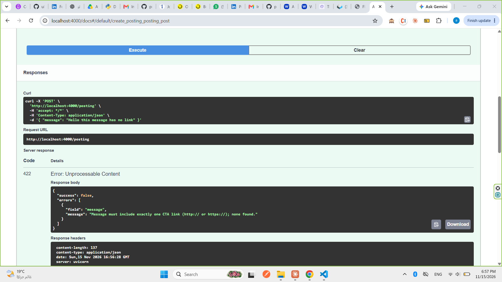 | 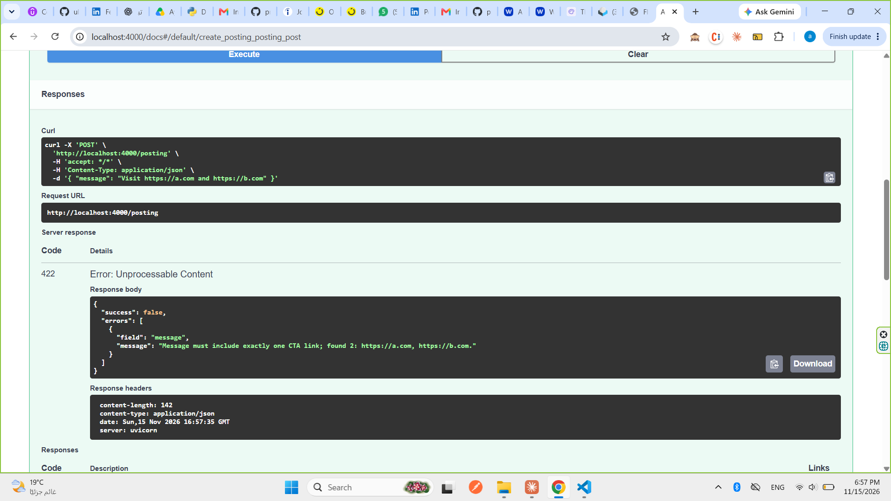 |

| Invalid domain | Over 200 characters |
|---|---|
| 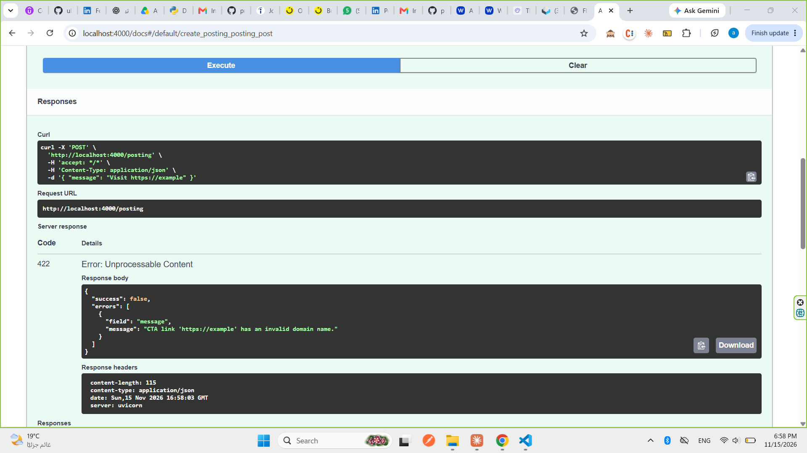 | 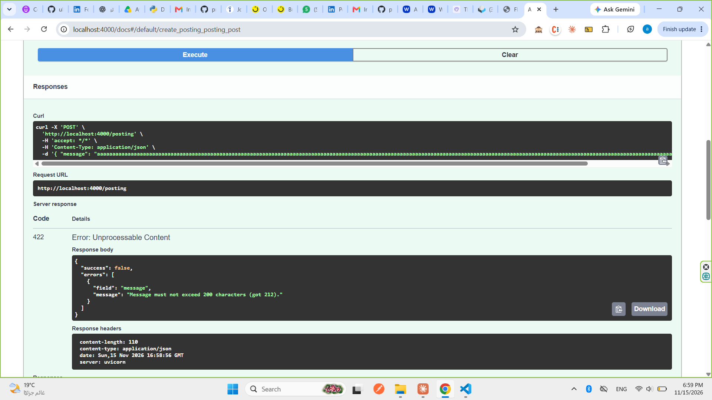 |

### Screenshots — live run on all five platforms

One `POST /posting` call published the same message to every platform. Times in the API are UTC; the platforms show local time (UTC+2).

**API response — all platforms `success`**

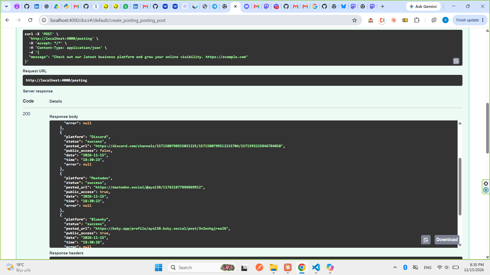

**The published posts**

| Telegram (public channel) | Discord (`#general` via webhook) |
|---|---|
| 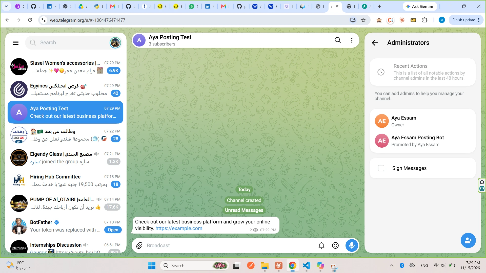 | 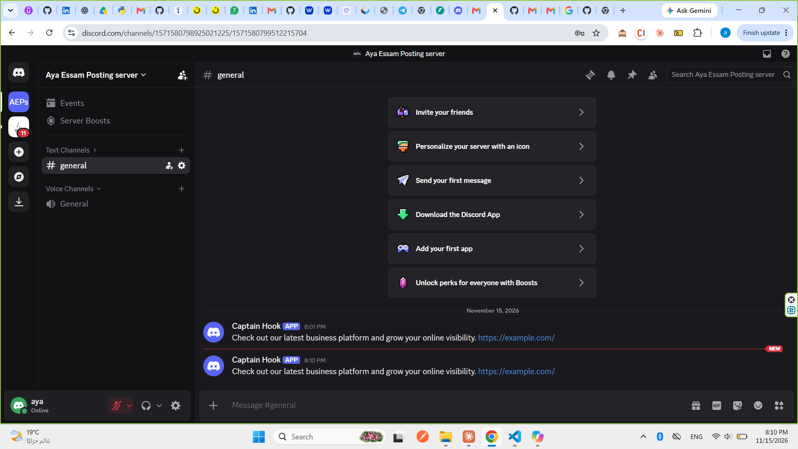 |

| Mastodon | Bluesky (clickable link facet) |
|---|---|
| 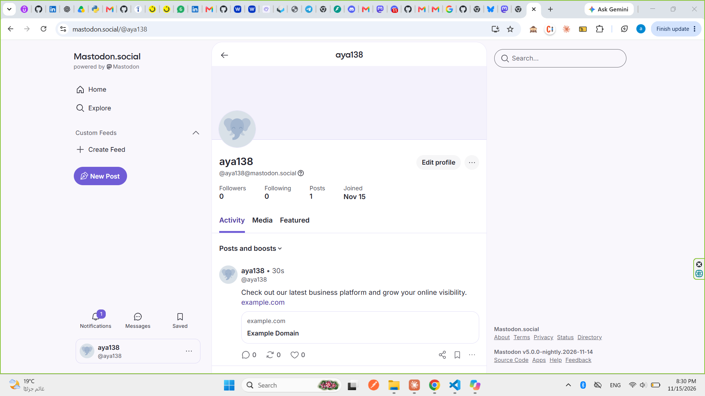 | 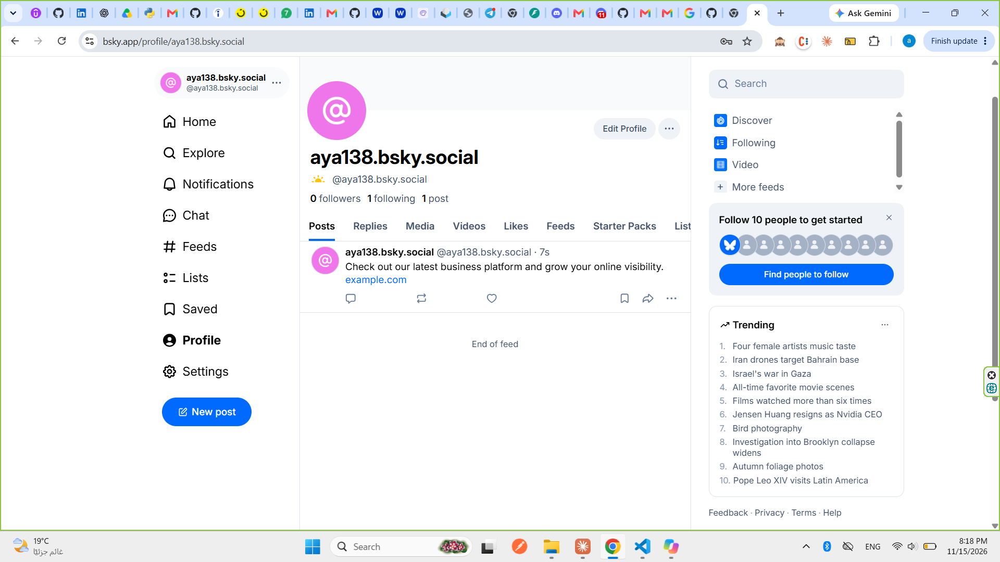 |

GitHub Gist result from an earlier run:

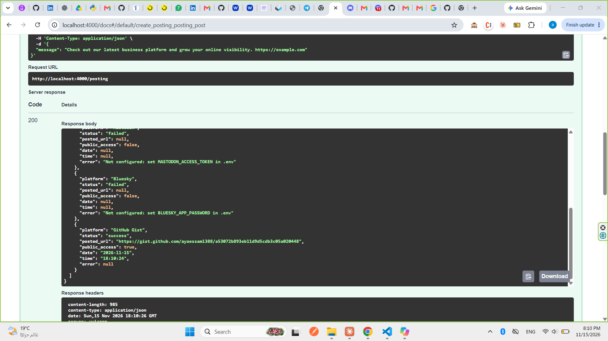

**Partial failure in a real run** — before the remaining credentials were added, Telegram published while the unconfigured platforms failed independently, showing that one failure never blocks the others:

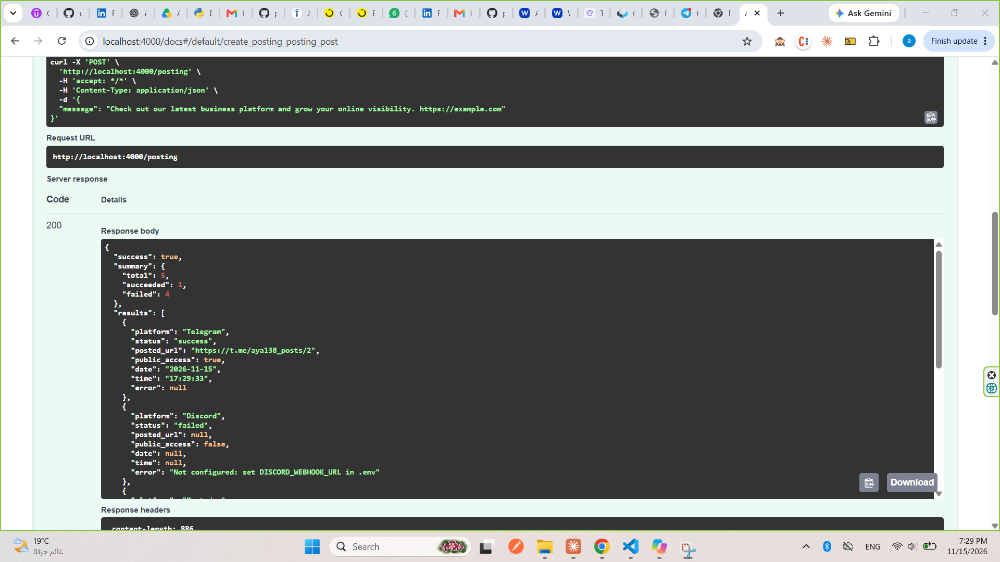

## Validation rules

| Rule | Example of rejected input | Error |
|---|---|---|
| Not empty (after trimming) | `"   "` | Message must not be empty. |
| Max 200 characters | 210-character message | Message must not exceed 200 characters (got 210). |
| Exactly one link | no link / two links | …none found. / …found 2: … |
| Link must have a scheme | `www.example.com` | …must start with http:// or https://. |
| http or https only | `ftp://…` is not detected as a link | …none found. |
| Valid domain with TLD | `https://example` | …has an invalid domain name. |
| No raw IP addresses | `http://127.0.0.1/admin` | …must use a domain name, not an IP address. |
| Valid port | `https://example.com:99999` | …has an invalid port. |

Trailing sentence punctuation is not treated as part of the link (`Visit https://example.com/offer.` is valid). Internationalised domains are checked in their IDNA (punycode) form.

## Error handling

| Situation | Result for that platform |
|---|---|
| Credentials missing in `.env` | `Not configured: set X, Y in .env` |
| API returns an error | `HTTP <code>: <platform's own error message>` |
| Request exceeds `REQUEST_TIMEOUT` (default 15s) | `Request timed out` |
| DNS / connection failure | `Network error (<ExceptionType>)` |
| Anything unexpected | `Unexpected error while posting` (full traceback in server log) |

One platform failing never affects the others. Each result is also logged:

```
2026-11-15 10:30:00 INFO posting: Telegram: success https://t.me/mychannel/42
2026-11-15 10:30:01 WARNING posting: Mastodon: failed - HTTP 401: The access token is invalid
```

## Tests

```bash
pytest -q
```

22 tests, no network access needed ([full run log](docs/test-run.txt)). Real platform classes run against `httpx.MockTransport`, covering:

- every validation rule above, through the HTTP endpoint;
- partial failure (one platform fails, the others still succeed) and all-fail;
- the exact request each platform sends and how its response becomes a result;
- Telegram error messages never leaking the bot token;
- Bluesky link facets using correct UTF-8 byte offsets for Arabic text;
- timeouts and network errors.

## Project structure

```
automated-posting/
├── app/
│   ├── main.py                  # FastAPI app, /posting and /health, validation error format
│   ├── config.py                # Settings from environment / .env (pydantic-settings)
│   ├── schemas.py               # Request/response models
│   ├── validators.py            # Message and URL rules
│   ├── platforms/
│   │   ├── __init__.py          # Platform registry
│   │   ├── base.py              # Platform contract, shared error/JSON helpers
│   │   ├── telegram.py
│   │   ├── discord.py
│   │   ├── mastodon.py
│   │   ├── bluesky.py
│   │   └── github_gist.py
│   └── services/
│       └── posting_service.py   # Concurrent posting with per-platform isolation
├── tests/
│   └── test_posting.py
├── .env.example
├── requirements.txt
└── README.md
```

### Adding a platform

1. Create `app/platforms/<name>.py` with a `Platform` subclass that sets `name`, `required_settings`, and implements `publish()`.
2. Add its settings to `app/config.py` and `.env.example`.
3. Register the class in `PLATFORM_CLASSES` in `app/platforms/__init__.py`.

## Design decisions

- **Concurrent, not sequential.** Total response time is roughly that of the slowest platform, not the sum of all of them.
- **One shared HTTP client** created in the app lifespan, so connections are pooled and the timeout is set in one place.
- **Secrets as `SecretStr`.** Credentials are not printed by accident in logs or reprs, and `.env` is git-ignored.
- **`public_access` comes from the platform**, not a guess: Mastodon's returned `visibility`, the Gist's `public` flag, whether the Telegram chat has a public username, and Discord is always members-only.
- **No retries on publish.** Retrying a write that may have succeeded risks duplicate public posts; failures are reported so the caller decides.
